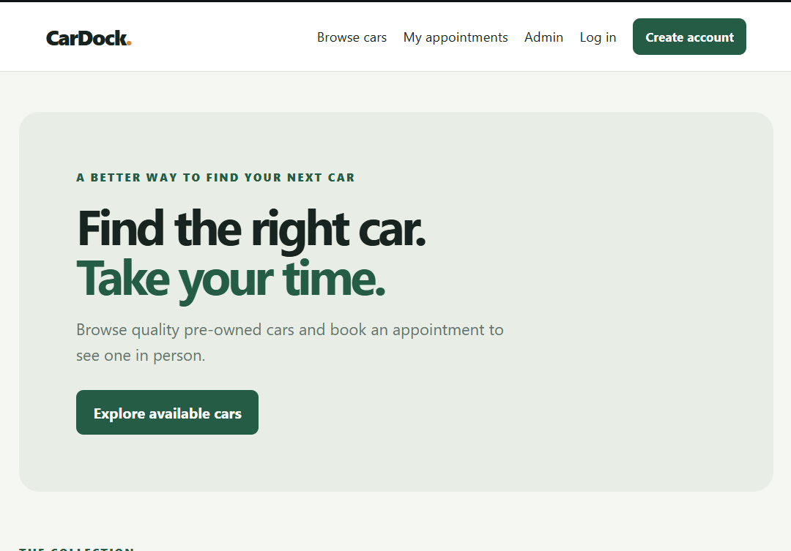
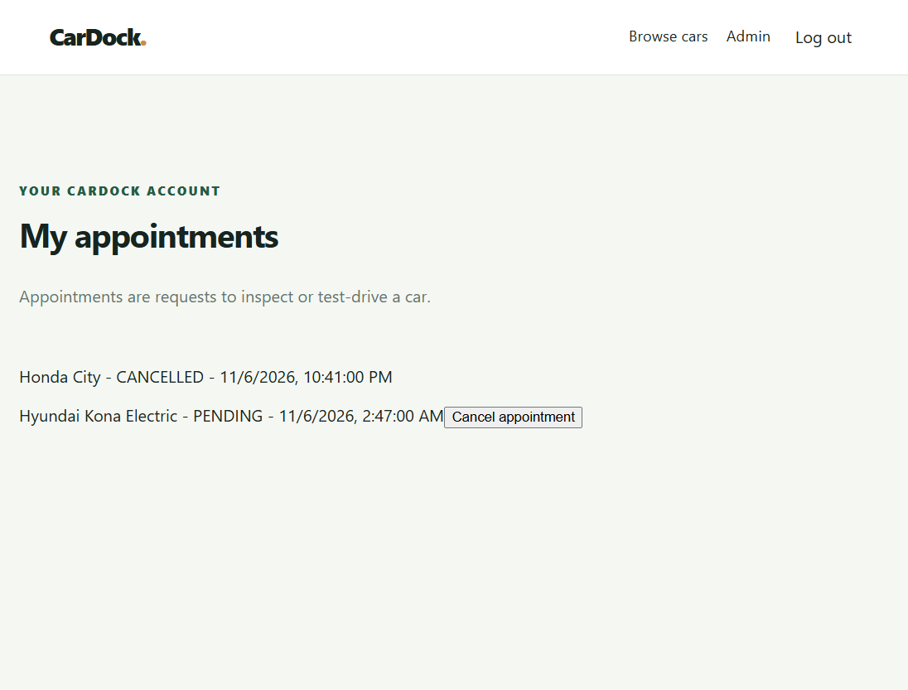
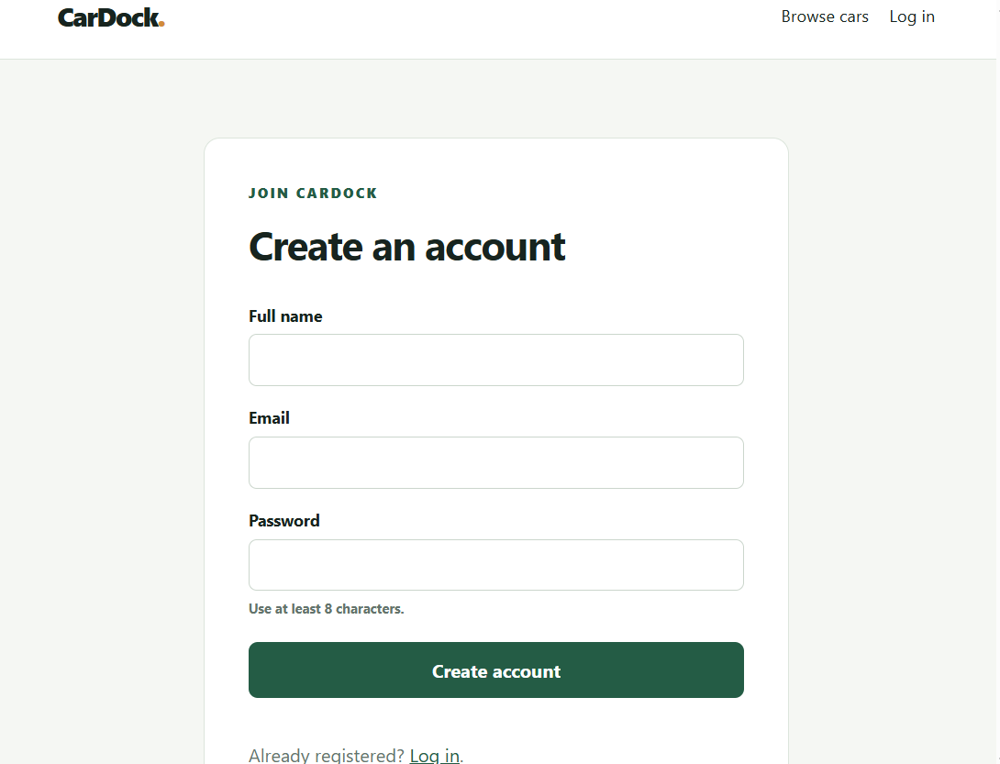

# CarDock

CarDock is a Java web project for browsing pre-owned cars and requesting inspection appointments.

## Technologies

- Java 25, Spring Boot, Spring Web, Spring Data JPA, Spring Security, and Bean Validation
- Maven
- H2 database for local use; PostgreSQL is also supported
- HTML, CSS, and basic JavaScript

## Main features

- Browse and search available cars from the database.
- Create an account and log in.
- Request, view, and cancel appointments.
- The backend APIs support admin management; the demo website has no admin dashboard.
- Backend validation and role-based access protect API operations.

## Run the project

You need JDK 25. Open PowerShell in the project folder and run:

```powershell
.\mvnw.cmd test
.\mvnw.cmd spring-boot:run
```

Open [http://localhost:8080](http://localhost:8080). The local profile uses an in-memory H2 database and sample cars.

## Screenshots

### Home page


### My appointments


### Create account


## Main folders and classes

- `src/main/java/com/cardock/controller`: receives API requests.
- `src/main/java/com/cardock/service`: contains application rules.
- `src/main/java/com/cardock/repository`: reads and writes database records.
- `src/main/java/com/cardock/entity`: defines users, cars, and appointments.
- `src/main/java/com/cardock/dto`: defines API request and response data.
- `src/main/resources/static`: contains the HTML pages, CSS, and simple JavaScript in `js/app.js`.
- `src/test/java/com/cardock`: contains integration tests.
- `CarDockApplication.java`: starts the Spring Boot application.
